<div align="center">


# ☄️ METEORO

**um survivors incremental em pixel art — direto no navegador**


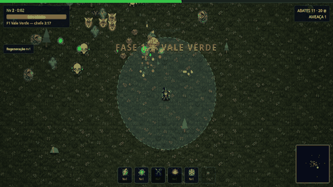

Você é um mago no meio da chuva de meteoros. As armas atiram sozinhas — seu trabalho é **não morrer**,
montar a build e atravessar as 10 fases. Inspirado em Vampire Survivors, Brotato e Halls of Torment.

### [▶ **JOGAR AGORA NO NAVEGADOR**](https://sovern.github.io/meteoro-survivors/)

[**Como jogar**](#-como-jogar) · [**O loop**](#-o-loop) · [**Bestiário**](#-bestiário) · [**Armas**](#-armas-10) · [**Dev**](#-dev)

</div>

---

## 🎮 Como jogar

**Online:** [sovern.github.io/meteoro-survivors](https://sovern.github.io/meteoro-survivors/) — sem instalar nada.

**Direto:** baixe o repo e abra `index.html` num navegador moderno. Pronto.

**Servidor local** (recomendado — garante que os sprites carreguem em qualquer navegador):

```bash
git clone https://github.com/sovern/meteoro-survivors.git
cd meteoro-survivors
python3 -m http.server 8000   # abra http://localhost:8000
```

Progresso (moedas, pontos, recordes, marcos) fica salvo no `localStorage` do navegador.

| Tecla | Ação |
|---|---|
| `WASD` / setas | Mover |
| `Espaço` | Dash (invencível por 0.28s) |
| `1` `2` `3` | Escolher upgrade no level-up |
| `P` / `Esc` | Pausar |
| `M` | Mudo |
| `Enter` | Começar / recomeçar |

## 🔁 O loop

1. **Sobreviva** até o chefe chegar (cada fase dura de ~3min a 5min).
2. **Mate o chefe** → +1 ponto de árvore, +1 ponto de arma, inimigos param de nascer.
3. **Limpe o resto** → portal abre onde o chefe caiu.
4. **Entre no portal** → +2 pontos de árvore, +1 ponto de arma, próxima fase.
5. **Morra ou zere** → moedas vão pro banco, pontos esperam na árvore.
6. **Gaste na árvore**, troque de mago/artefato, tente de novo mais forte.

Zerou as 10 fases? O **modo infinito** continua escalando pra sempre.

<div align="center">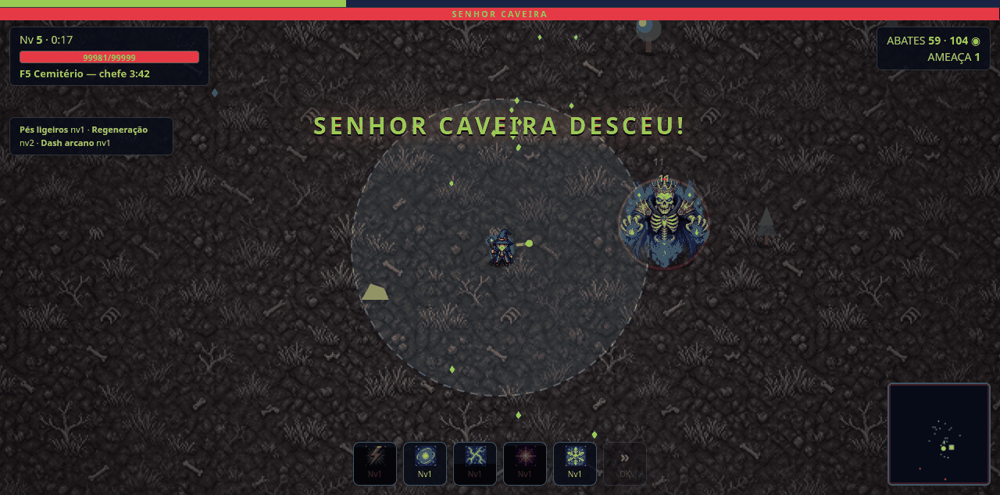</div>

## 👾 Bestiário

<div align="center">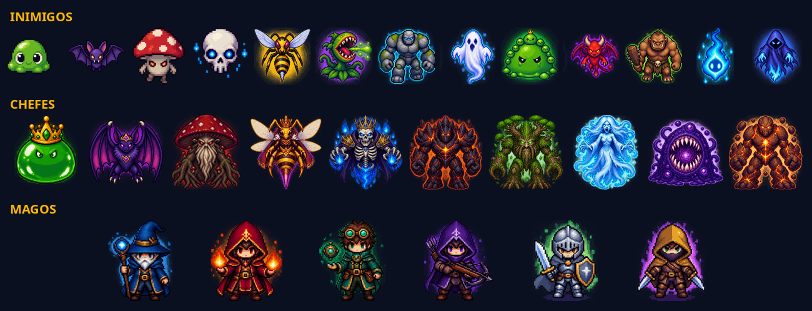</div>

13 tipos de inimigo, 10 chefes com arte e padrões próprios (radial, espiral, leque, invocação, investida, teleporte)
e 6 magos jogáveis. Tudo em pixel art 16-bit, animado por código (squash, bater de asas, flutuar, balanço).

### Fases e chefes

| # | Fase | Chefe | | Duração |
|---|---|---|:-:|---|
| 1 | Vale Verde | REI GOSMA | 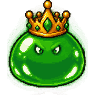 | 3:20 |
| 2 | Cavernas Cinzentas | RAINHA MORCEGO | 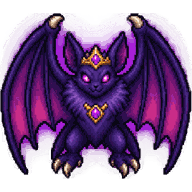 | 3:30 |
| 3 | Pântano Fétido | COGUMELO ANCIÃO | 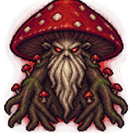 | 3:40 |
| 4 | Deserto Uivante | IMPERATRIZ VESPA | 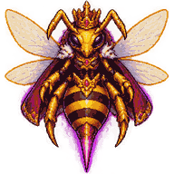 | 3:50 |
| 5 | Cemitério | SENHOR CAVEIRA |  | 4:00 |
| 6 | Vulcão | GOLEM DE OBSIDIANA | 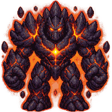 | 4:10 |
| 7 | Floresta Sombria | TREANT MILENAR | 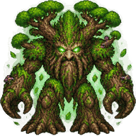 | 4:20 |
| 8 | Geleira | BANSHEE |  | 4:30 |
| 9 | O Vazio | DEVORADOR | 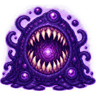 | 4:45 |
| 10 | Trono do Meteoro | O METEORO (enfurece!) | 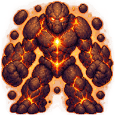 | 5:00 |

Cada fase tem chão temático em pixel art (grama, caverna, pântano, deserto, cemitério, lava, floresta, gelo, vazio cósmico e cratera), elenco e padrões de chefe próprios.

## ⚔️ Armas (10)

<div align="center">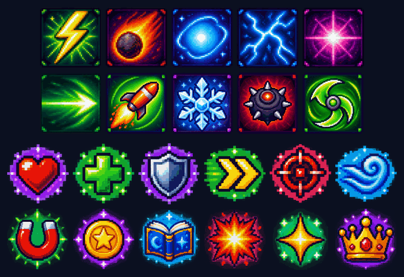</div>

| Arma | Estilo | Evolução |
|---|---|---|
| Raio | Disparo automático no mais próximo (arma inicial) | Tempestade de Lâminas |
| Meteoro | Cai na maior concentração de inimigos (desbloqueável) | Chuva Ígnea (queima o chão) |
| Orbe orbital | Gira em volta de você | Sistema Planetário |
| Cadeia de raios | Pula entre inimigos | Julgamento Final |
| Nova arcana | Explosão periódica ao redor | Big Bang |
| Feixe perfurante | Atravessa a horda | Canhão Orbital |
| Mísseis teleguiados | Saraivada no mais próximo | Tempestade de Mísseis (área) |
| Aura de gelo | Fere e desacelera quem chega perto | Era do Gelo |
| Campo minado | Minas por proximidade | Terra Arrasada |
| Bumerangue | Lâminas orbitando rápido | Lâminas do Vendaval |

Na run, cada arma tem **4 upgrades** (desbloqueio + 3). Fora da run, cada arma tem sua **mini-árvore de 13 nodos** com a **evolução** no final.

## 🌳 Árvore passiva (126 nodos)

- **100 nodos normais** em 13 setores assimétricos (um por arma + corpo + fortuna + sombras).
- **16 notables** com bônus grandes (projétil extra, +150 vida, +12% todo dano…).
- **10 portais de arma** (losangos): cada um desbloqueia a mini-árvore daquela arma.
- Pontos de árvore: chefes (+1) e fases (+2). Dá pra comprar ponto com moedas (cada vez mais caro) e resetar tudo de graça.

## 🧙 Magos (6)

| | Mago | Bônus |
|:-:|---|---|
|  | Mago | Equilibrado, o clássico |
|  | Piromante | +50% dano do meteoro, −20 vida |
|  | Engenheiro | +30% dano dos orbes |
|  | Caçador | +15% crítico |
| 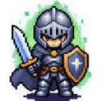 | Cavaleiro | +60 vida, +5 armadura, −8% velocidade |
| 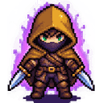 | Ladino | +15% velocidade, +8% esquiva |

Toda run começa só com o Raio (disparo básico) — as outras 9 armas desbloqueiam nos level-ups.

## 💎 Artefatos (8) e marcos

Artefatos têm **lado bom e lado ruim** (ex.: +50% moedas, −30 vida) e desbloqueiam por **marcos persistentes**:

| Artefato | Marco |
|---|---|
| Dado Viciado | 1000 abates totais |
| Luneta | Nível 12 numa run |
| Moeda Amaldiçoada | 800 moedas bancadas |
| Coração de Pedra | Alcançar a fase 4 |
| Manopla Rúnica | 8 chefes mortos |
| Pena do Vento | Zerar as 10 fases |
| Bússola do Caos | 20 fases limpas |
| Relógio Solar | 20min numa run |

## 💡 Dicas

- **Não ignore a árvore.** A fase 5+ cobra os bônus — árvore vazia não passa.
- **Primeira evolução:** o Raio é a única arma garantida; a ordem das outras muda a cada run.
- **Dash é vida:** 0.28s de invencibilidade atravessa padrão de chefe.
- **Aura de gelo + minas** segura horda enquanto o meteoro limpa.
- **Elites** (douradas) pagam 15 moedas e largam coração — vale o risco.

## 🤖 Bots que aprendem

O jogo vem com um bot jogável (`index.html#bot`, 1000 sessões, timescale até x64)
e um laboratório de ML em `ml/`: algoritmo genético sobre 31 parâmetros do bot,
neuroevolução de uma rede 12-8-3 e clonagem comportamental com backprop em Python
puro. Placar atual: GA chega na **F5**, rede evoluída atravessa o portal da F1.

## 🛠 Dev

```
index.html       UI, HUD, overlays, telas
game.js          motor: loop, combate, 10 armas, 13 inimigos, render, saves
data-tree.js     árvore passiva (gerada, conectividade garantida)
data-wtree.js    10 mini-árvores de arma + evoluções
data-stages.js   10 fases, temas, chefes e padrões
data-meta.js     magos, artefatos e marcos
sprites/         pixel art: 13 inimigos, 10 chefes, 6 magos (PNG transparente)
icons/           sprite sheets (weapons 5x2, tree-stats 6x2)
tools/           codeindex.py (mapa do código) · test.sh (testes headless)
ml/              laboratório de bots: GA, neuroevolução, backprop (ver ml/README.md)
docs/            mídia do README
```

**Testes** — sem framework, sem Node (o JS headless roda com `gjs`):

```bash
tools/test.sh          # rápido (~5s): bot joga 12k frames → GLUE PASS
tools/test.sh full     # 100 sessões com meta-progressão (~8min)
# navegador real: abra index.html#selftest → SELFTEST PASS (eventos de verdade, 0 erros JS)
```

**Mapa do código** — o `game.js` tem ~3800 linhas; não precisa ler tudo:

```bash
python3 tools/codeindex.py               # gera CODEMAP.md (seções → funções → linhas)
python3 tools/codeindex.py find boss     # acha funções, consts, campos de state, ids de dados
python3 tools/codeindex.py show drawEnemy
```

Trabalhando com agentes de IA? Leia o [`AGENTS.md`](AGENTS.md) (regras do projeto, arquitetura e pipeline de arte).

## 🗺 Roadmap

- [ ] Mais 2–3 armas (ideias: tornado, espada voadora, raio orbital)
- [ ] Baús de elite com escolha de 1 entre 3
- [ ] Reroll/skip/banish no level-up
- [ ] Dailies com seed fixa e ranking local
- [ ] Modo chefão-rush (só chefes, sem fases)
- [x] Chão temático por fase em pixel art
- [ ] Sprites de cenário (árvores, pedras, cristais) em pixel art

---

<div align="center">

Feito com vanilla JS + canvas. Nenhum meteoro foi maltratado. ☄️

</div>
