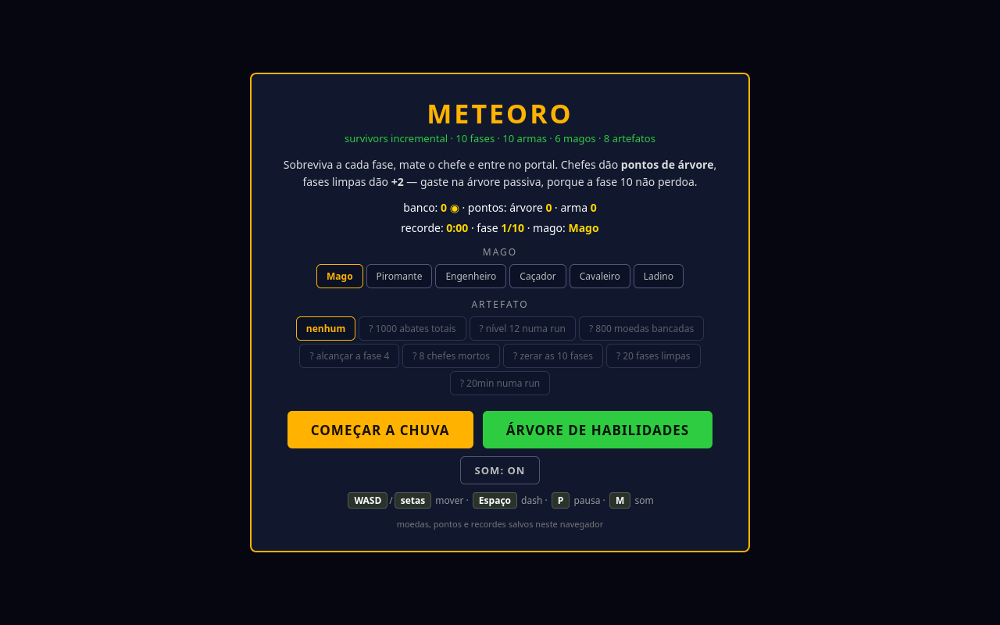

# ☄️ METEORO — survivors incremental

    

Um **survivors incremental** completo no navegador: você é um mago no meio da chuva de meteoros, as armas atiram sozinhas e o seu trabalho é **não morrer**, montar a build e atravessar as 10 fases. Inspiração: Vampire Survivors, Brotato, Halls of Torment. Tudo desenhado em código (canvas 2D), zero assets externos, zero dependências.



## Como jogar

**Opção 1 — direto (mais fácil):** baixe o repo e abra `index.html` em qualquer navegador moderno. Pronto.

**Opção 2 — servidor local:**

```bash
git clone https://github.com/sovern/meteoro-survivors.git
cd meteoro-survivors
python3 -m http.server 8000
# abra http://localhost:8000
```

Progresso (moedas, pontos, recordes, marcos) fica salvo no `localStorage` do navegador.

## Controles

| Tecla | Ação |
|---|---|
| `WASD` / setas | Mover |
| `Espaço` | Dash (invencível por 0.28s) |
| `1` `2` `3` | Escolher upgrade no level-up |
| `P` / `Esc` | Pausar |
| `M` | Mudo |
| `Enter` | Começar / recomeçar |

## O loop

1. **Sobreviva** até o chefe chegar (cada fase dura de ~3min a 5min).
2. **Mate o chefe** → +1 ponto de árvore, +1 ponto de arma, portal abre.
3. **Entre no portal** → +2 pontos de árvore, +1 ponto de arma, próxima fase.
4. **Morra ou zere** → moedas vão pro banco, pontos esperam na árvore.
5. **Gaste na árvore**, troque de mago/artefato, tente de novo mais forte.

Zerou as 10 fases? O **modo infinito** continua escalando pra sempre.

## Armas (10)

| Arma | Estilo | Evolução |
|---|---|---|
| Raio | Disparo automático no mais próximo (arma inicial) | Tempestade de Lâminas |
| Meteoro | Cai na maior concentração de inimigos (desbloqueável) | Chuva Ígnea (queima o chão) |
| Orbe orbital | Gira em volta de você | Sistema Planetário |
| Cadeia de raios | Pula entre inimigos | Julgamento Final |
| Nova arcana | Explosão periódica ao redor | Big Bang |
| Feixe perfurante | Atravessa a horda | Canhão Orbital |
| Mísseis teleguiados | Saraivada no mais próximo | Tempestade de Mísseis (área) |
| Aura de gelo | Fere e desacelera quem chega perto | Era do Gelo |
| Campo minado | Minas por proximidade | Terra Arrasada |
| Bumerangue | Lâminas orbitando rápido | Lâminas do Vendaval |

Na run, cada arma tem **4 upgrades** (desbloqueio + 3). Fora da run, cada arma tem sua **mini-árvore de 13 nodos** com a **evolução** no final.

## Árvore passiva (126 nodos)

- **100 nodos normais** em 13 setores assimétricos (um por arma + corpo + fortuna + sombras).
- **16 notables** com bônus grandes (projétil extra, +150 vida, +12% todo dano…).
- **10 portais de arma** (losangos): cada um desbloqueia a mini-árvore daquela arma.
- Pontos de árvore: chefes (+1) e fases (+2). Dá pra comprar ponto com moedas (cada vez mais caro) e resetar tudo de graça.

## Magos (6)

| Mago | Bônus |
|---|---|
| Mago | Equilibrado, o clássico |
| Piromante | +50% dano do meteoro, −20 vida |
| Engenheiro | Já começa com o Orbe, +30% dano dele |
| Caçador | Já começa com a Cadeia, +15% crítico |
| Cavaleiro | +60 vida, +5 armadura, −8% velocidade |
| Ladino | Já começa com Bumerangue, +15% velocidade, +8% esquiva |

## Artefatos (8) e marcos

Artefatos têm **lado bom e lado ruim** (ex.: +50% moedas, −30 vida) e desbloqueiam por **marcos persistentes**:

| Artefato | Marco |
|---|---|
| Dado Viciado | 1000 abates totais |
| Luneta | Nível 12 numa run |
| Moeda Amaldiçoada | 800 moedas bancadas |
| Coração de Pedra | Alcançar a fase 4 |
| Manopla Rúnica | 8 chefes mortos |
| Pena do Vento | Zerar as 10 fases |
| Bússola do Caos | 20 fases limpas |
| Relógio Solar | 20min numa run |

## Fases e chefes

| # | Fase | Chefe | Duração |
|---|---|---|---|
| 1 | Vale Verde | REI GOSMA | 3:20 |
| 2 | Cavernas Cinzentas | RAINHA MORCEGO | 3:30 |
| 3 | Pântano Fétido | COGUMELO ANCIÃO | 3:40 |
| 4 | Deserto Uivante | IMPERATRIZ VESPA | 3:50 |
| 5 | Cemitério | SENHOR CAVEIRA | 4:00 |
| 6 | Vulcão | GOLEM DE OBSIDIANA | 4:10 |
| 7 | Floresta Sombria | TREANT MILENAR | 4:20 |
| 8 | Geleira | BANSHEE | 4:30 |
| 9 | O Vazio | DEVORADOR | 4:45 |
| 10 | Trono do Meteoro | O METEORO (enfurece!) | 5:00 |

Cada fase tem elenco, tema visual e padrões de chefe próprios (radial, espiral, leque, invocação, investida, teleporte).

## Dicas

- **Não ignore a árvore.** A fase 5+ cobra os bônus — árvore vazia não passa.
- **Primeira evolução:** Raio ou Meteoro, que você já tem desde o nível 1.
- **Dash é vida:** 0.28s de invencibilidade atravessa padrão de chefe.
- **Aura de gelo + minas** segura horda enquanto o meteoro limpa.
- **Elites** (douradas) pagam 15 moedas e largam coração — vale o risco.

## Estrutura

```
index.html       UI, HUD, overlays, telas
game.js          motor: loop, combate, 10 armas, 13 inimigos, saves
data-tree.js     árvore passiva (gerada, conectividade garantida)
data-wtree.js    10 mini-árvores de arma + evoluções
data-stages.js   10 fases, temas, chefes e padrões
data-meta.js     magos, artefatos e marcos
icons/           sprite sheets (weapons 5x2, tree-stats 6x2)
ml/              laboratório de bots: GA, neuroevolução, backprop (ver ml/README.md)
```

## Bots que aprendem

O jogo vem com um bot jogável (`index.html#bot`, 1000 sessões, timescale até x64)
e um laboratório de ML em `ml/`: algoritmo genético sobre 31 parâmetros do bot,
neuroevolução de uma rede 12-8-3 e clonagem comportamental com backprop em Python
puro. Placar atual: GA chega na **F5**, rede evoluída atravessa o portal da F1.

## Dev: testes

Sem framework, dois níveis:

```bash
# 1. Harness de lógica (gjs): dados + regras + run simulada de 11 fases
gjs /tmp/smoke_meteoro4.js   # HARNESS-V4 PASS

# 2. Selftest no navegador real (eventos de verdade, 0 erros JS)
firefox --headless --screenshot shot.png 'file:///caminho/index.html#selftest'
# SELFTEST PASS ... frames=52
```

## Roadmap

- [ ] Mais 2–3 armas (ideias: tornado, espada voadora, raio orbital)
- [ ] Baús de elite com escolha de 1 entre 3
- [ ] Reroll/skip/banish no level-up
- [ ] Dailies com seed fixa e ranking local
- [ ] Modo chefão-rush (só chefes, sem fases)

---

Feito com vanilla JS + canvas. Nenhum meteoro foi maltratado.
